<div align="center">


# ☁️ Material da Liga de Computação em Nuvem

**Slides, desafios práticos e simulados da trilha de cloud da Liga de Computação em Nuvem da PUCRS.**<br />
Tudo o que é apresentado nos encontros fica aqui, em PDF, para estudar no seu ritmo.

<br />

[](https://aws.amazon.com/certification/certified-cloud-practitioner/)
[](#-aulas)
[](#-desafios-práticos)
[](#-simulados-clf-c02)

[](https://www.meetup.com/aws-sbg-pucrs/)
[](https://builder.aws.com/)
[](https://www.pucrs.br/politecnica/)

**[Handbook](#-handbook-do-membro)** · **[Aulas](#-aulas)** · **[Desafios](#-desafios-práticos)** · **[Simulados](#-simulados-clf-c02)** · **[Como estudar](#-como-estudar-com-este-material)**

</div>

---

## 👋 Sobre a Liga

A **Liga de Computação em Nuvem (LCN)** é o grupo de estudantes de cloud da **Escola Politécnica da PUCRS**, ligado ao programa **AWS Student Builder Group**. A ideia é aprender nuvem na prática: teoria e hands-on em conta AWS, preparação para a certificação e projetos com casos reais, trabalhados em squads.

<div align="center">

| 📅 Quando | 📍 Onde | 🗓️ Semestre 2026/2 | 🎯 Foco |
|:---:|:---:|:---:|:---:|
| Quintas, 15h30–17h | Prédio 32, sala 517 | 06/08 → 03/12 · 18 encontros | AWS Cloud Practitioner |

</div>

O semestre é dividido em **4 ciclos**:

| Ciclo | Período | Foco |
|---|---|---|
| 🧭 **1 · Onboarding e ferramentas** | agosto | Abertura da Liga, ecossistema AWS, Console, Docker e Terraform |
| 🏅 **2 · Certificação CLF-C02** | setembro | Os 4 domínios do exame e simulados |
| 🤝 **3 · Case com cliente A** | outubro | Squad: case, arquitetura, Terraform e apresentação |
| 🚀 **4 · Case com cliente B** | novembro → 03/12 | Squad: case, arquitetura, Terraform e apresentação |

---

## 📖 Handbook do membro

<table>
<tr>
<td width="32%">
<a href="handbook/liga-nuvem-handbook-2026-2.pdf">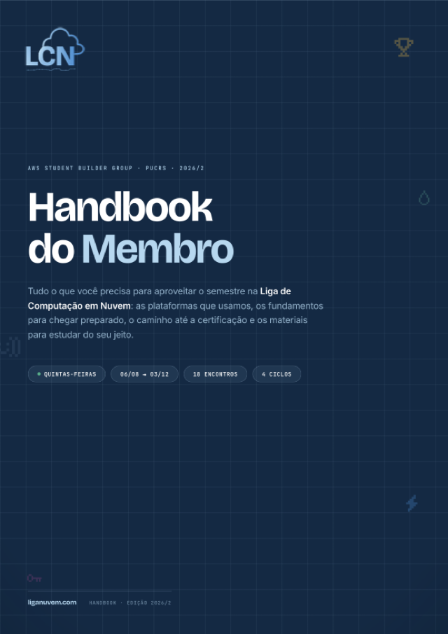</a>
</td>
<td>

**Comece por aqui.** O handbook reúne o que você precisa para aproveitar o semestre:

- 🧰 as plataformas que a Liga usa (Skill Builder, Credly, Meetup)
- 📐 os fundamentos para chegar preparado nos encontros
- 🏅 o caminho até a certificação
- 📚 materiais extras para estudar do seu jeito

📄 **[Abrir o handbook (PDF)](handbook/liga-nuvem-handbook-2026-2.pdf)**

</td>
</tr>
</table>

---

## 🎓 Aulas

A aula 01 abre a Liga. Da 02 em diante, os decks percorrem os serviços e conceitos cobrados no exame **CLF-C02**. Os decks 03 a 10 terminam com pegadinhas clássicas e questões no estilo da prova. Clique na capa para abrir o PDF.

<table>
<tr>
<td width="50%" valign="top">
<a href="aulas/01-encontro-inaugural.pdf">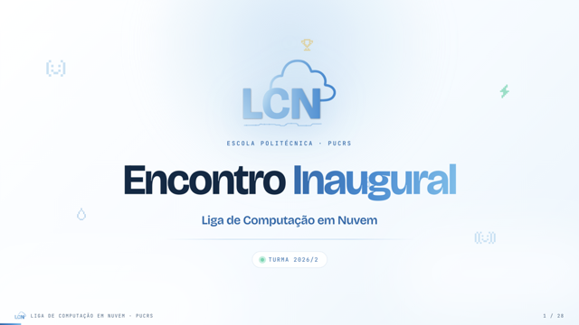</a>
<b>01 · Encontro inaugural</b><br />
<sub>A proposta da Liga, os ciclos do semestre e o ecossistema do AWS Student Builder Group.</sub>
</td>
<td width="50%" valign="top">
<a href="aulas/02-introducao-aws.pdf">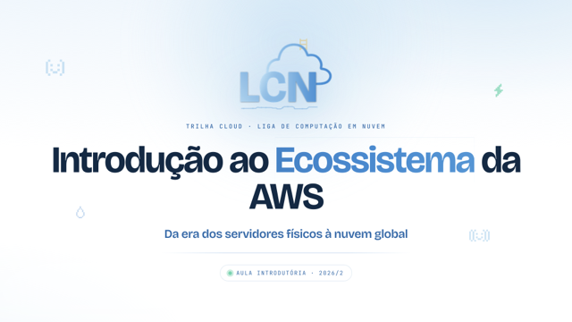</a>
<b>02 · Introdução ao ecossistema da AWS</b><br />
<sub>De on-premise a on-demand, regiões e AZs, S3, EC2, Docker e IAM, com hands-on subindo backend e frontend.</sub>
</td>
</tr>
<tr>
<td valign="top">
<a href="aulas/03-armazenamento-e-banco-de-dados.pdf">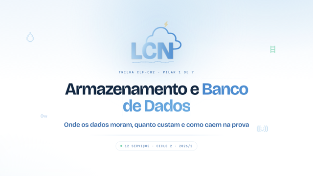</a>
<b>03 · Armazenamento e banco de dados</b><br />
<sub>S3, EBS, EFS, FSx, Storage Gateway, RDS, Aurora, DynamoDB, ElastiCache, Redshift, DocumentDB e Neptune.</sub>
</td>
<td valign="top">
<a href="aulas/04-computacao-e-integracao.pdf">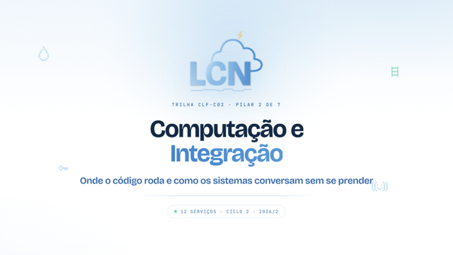</a>
<b>04 · Computação e integração</b><br />
<sub>EC2, Lambda, ECS, EKS, Fargate, Elastic Beanstalk, Lightsail, Batch, SQS, SNS, EventBridge e Step Functions.</sub>
</td>
</tr>
<tr>
<td valign="top">
<a href="aulas/05-redes-e-monitoramento.pdf">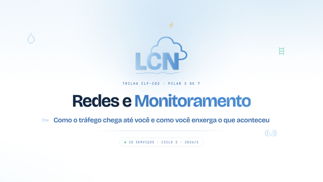</a>
<b>05 · Redes e monitoramento</b><br />
<sub>VPC, Route 53, CloudFront, API Gateway, Direct Connect, ELB, CloudWatch, CloudTrail, X-Ray e Config.</sub>
</td>
<td valign="top">
<a href="aulas/06-seguranca.pdf">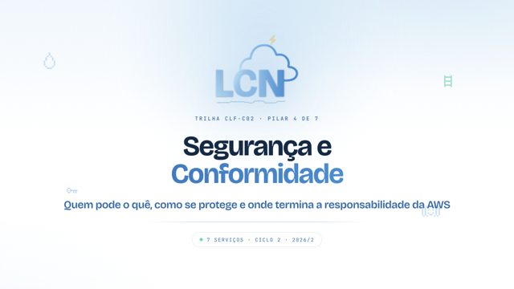</a>
<b>06 · Segurança e conformidade</b><br />
<sub>IAM, KMS, Cognito, WAF, Secrets Manager, Shield e GuardDuty.</sub>
</td>
</tr>
<tr>
<td valign="top">
<a href="aulas/07-devops-e-analytics.pdf">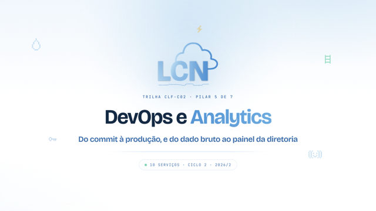</a>
<b>07 · DevOps e analytics</b><br />
<sub>CodeCommit, CodeBuild, CodeDeploy, CodePipeline, CloudFormation, Athena, Glue, EMR, Kinesis e QuickSight.</sub>
</td>
<td valign="top">
<a href="aulas/08-ia-e-machine-learning.pdf">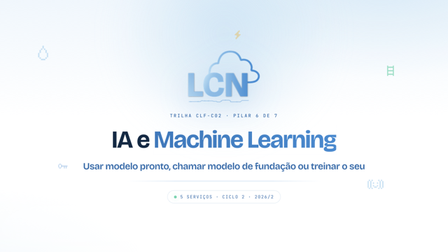</a>
<b>08 · IA e machine learning</b><br />
<sub>Rekognition, Comprehend, Textract, Bedrock e SageMaker.</sub>
</td>
</tr>
<tr>
<td valign="top">
<a href="aulas/09-well-architected-e-caf.pdf">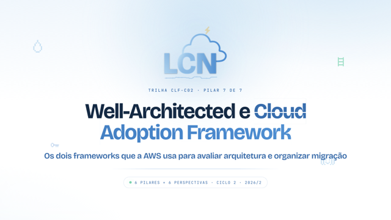</a>
<b>09 · Well-Architected e Cloud Adoption Framework</b><br />
<sub>Os seis pilares do Well-Architected, as seis perspectivas do CAF e os planos de suporte.</sub>
</td>
<td valign="top">
<a href="aulas/10-outros-servicos.pdf">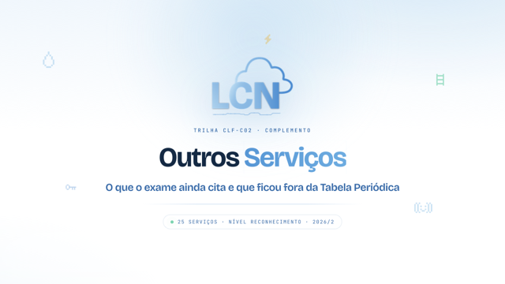</a>
<b>10 · Outros serviços</b><br />
<sub>Os serviços que caem na prova só pelo nome: governança, usuário final, migração e custos, com flashcards.</sub>
</td>
</tr>
</table>

---

## 🧩 Desafios práticos

Cada desafio traz um cliente fictício com um problema de nuvem de verdade. O **enunciado** descreve a missão e os critérios de entrega. O **guia** mostra um caminho de resolução, passo a passo, e cada desafio tem um extra para quem quiser ir além.

<table>
<tr>
<td width="33%" valign="top">
<a href="desafios/01-dojo-digital/enunciado.pdf">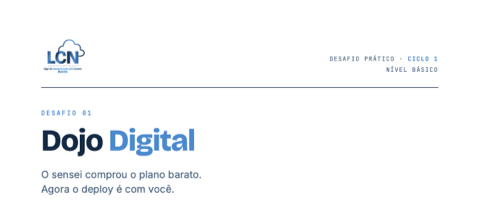</a>
<b>🥋 01 · Dojo Digital</b> <sup>básico</sup><br />
<sub>O sensei comprou o plano barato e o deploy sobrou para você. API em Docker numa <b>EC2</b>, PostgreSQL via Docker Compose e o frontend como SPA no <b>S3</b>.<br />⭐ Extra: <b>VPC Endpoint</b> para o S3.</sub><br /><br />
📄 <a href="desafios/01-dojo-digital/enunciado.pdf">Enunciado</a> · 🧭 <a href="desafios/01-dojo-digital/guia.pdf">Guia</a>
</td>
<td width="33%" valign="top">
<a href="desafios/02-girobet/enunciado.pdf">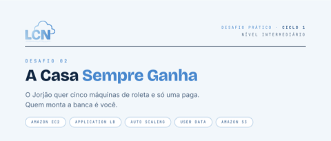</a>
<b>🎰 02 · A Casa Sempre Ganha</b> <sup>intermediário</sup><br />
<sub>A GiroBet não pode cair nunca. <b>Application Load Balancer</b>, <b>Auto Scaling Group</b> em várias AZs, User Data e Security Groups encadeados.</sub><br /><br />
📄 <a href="desafios/02-girobet/enunciado.pdf">Enunciado</a> · 🧭 <a href="desafios/02-girobet/guia.pdf">Guia</a>
</td>
<td width="33%" valign="top">
<a href="desafios/03-caixa-de-lembrancas/enunciado.pdf">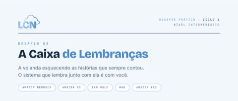</a>
<b>📦 03 · A Caixa de Lembranças</b> <sup>intermediário</sup><br />
<sub>Um chat com <b>RAG</b> que responde com a voz da Dona Cecília. Lembranças no <b>S3</b>, EC2 autenticada por <b>IAM Role</b> e <b>Amazon Bedrock</b>.</sub><br /><br />
📄 <a href="desafios/03-caixa-de-lembrancas/enunciado.pdf">Enunciado</a> · 🧭 <a href="desafios/03-caixa-de-lembrancas/guia.pdf">Guia</a>
</td>
</tr>
</table>

> [!TIP]
> Tente resolver só com o enunciado antes de abrir o guia. Travou? Leve a dúvida para o encontro de quinta.

> [!WARNING]
> Os desafios criam recursos de verdade na sua conta AWS. Fique no Free Tier, configure um alerta de billing e **apague tudo** ao terminar.

---

## 📝 Simulados CLF-C02

<table>
<tr>
<td width="32%">
<a href="simulados/simulado-clf-c02-01.pdf">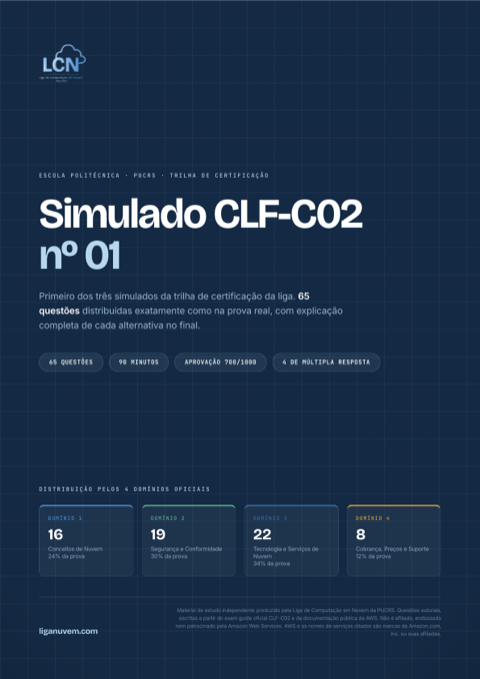</a>
</td>
<td>

Cinco simulados autorais com **65 questões cada**: 325 questões no total, sem repetir assunto entre eles. Cada um traz gabarito e a explicação de todas as alternativas. A distribuição segue os pesos oficiais do exame:

| Domínio | Peso | Questões |
|---|:---:|:---:|
| 🧠 D1 · Cloud Concepts | 24% | 16 |
| 🔐 D2 · Security and Compliance | 30% | 19 |
| ⚙️ D3 · Cloud Technology and Services | 34% | 22 |
| 💰 D4 · Billing, Pricing, and Support | 12% | 8 |

⏱️ **90 minutos** · 🎯 **aprovação: 700/1000** · ☑️ **4 questões de múltipla resposta**

</td>
</tr>
</table>

<div align="center">

[](simulados/simulado-clf-c02-01.pdf)
[](simulados/simulado-clf-c02-02.pdf)
[](simulados/simulado-clf-c02-03.pdf)
[](simulados/simulado-clf-c02-04.pdf)
[](simulados/simulado-clf-c02-05.pdf)

</div>

---

## 🗺️ Como estudar com este material

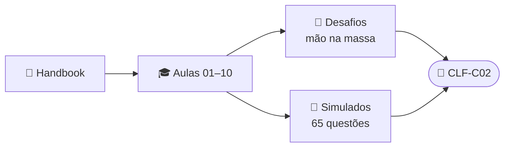

1. **Leia o handbook** para entender como a Liga funciona.
2. **Acompanhe as aulas** em ordem: do deck 03 em diante, cada um fecha com questões no estilo da prova.
3. **Faça os desafios** para fixar o que viu, colocando a mão na conta AWS.
4. **Faça os simulados** cronometrados e sem consulta. Passando com folga nos cinco? Hora de agendar o exame.

## 🗂️ Estrutura do repositório

```
📁 handbook/     guia do membro para o semestre
📁 aulas/        slides de cada encontro (01 a 10)
📁 desafios/     enunciado + guia de cada desafio prático
📁 simulados/    5 simulados da CLF-C02
```

## 🔗 Links úteis

| Link | Para quê |
|---|---|
| 🎓 [AWS Skill Builder](https://skillbuilder.aws/) | Cursos gratuitos e o *Cloud Practitioner Essentials* |
| 📘 [Guia do exame CLF-C02](https://docs.aws.amazon.com/aws-certification/latest/cloud-practitioner-02/cloud-practitioner-02.html) | O que cai na prova, oficialmente |
| 🛠️ [AWS Builder Center](https://builder.aws.com/) | Comunidade e conteúdo para builders |
| 🗓️ [Meetup da Liga](https://www.meetup.com/aws-sbg-pucrs/) | Encontros e eventos |

---

<div align="center">
<sub>Feito com ☁️ pela <b>Liga de Computação em Nuvem · PUCRS</b>, para os membros da Liga.<br />
Material de estudo independente. AWS e os nomes dos serviços são marcas da Amazon.com, Inc. ou de suas afiliadas.</sub>
</div>
